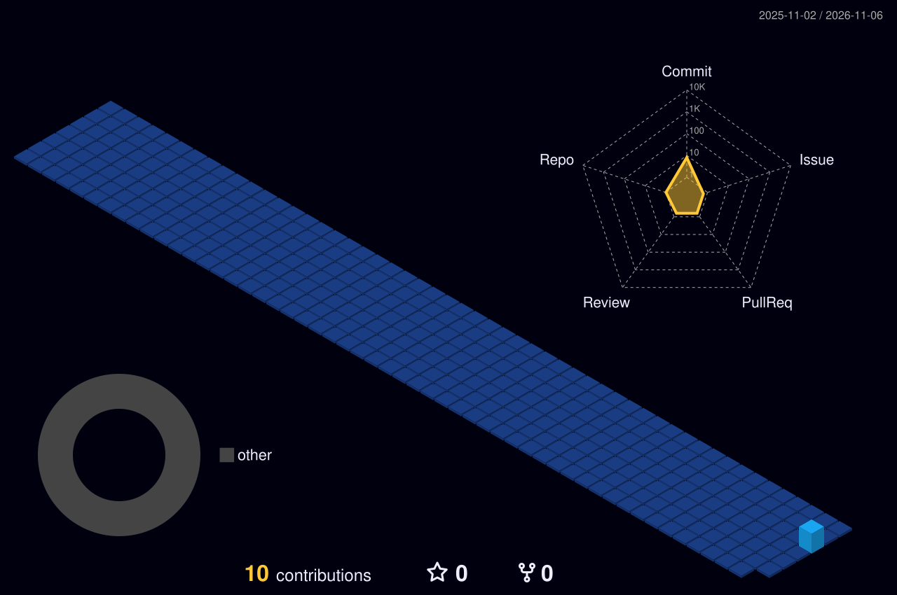

<!-- ── YIN · presentation ─────────────────────────────────────────── -->

<picture>
  <source media="(prefers-color-scheme: dark)" srcset="https://capsule-render.vercel.app/api?type=venom&color=0:000000,100:2b2b2b&height=210&section=header&text=WebBreda&fontSize=64&fontColor=ffffff&stroke=ffffff&strokeWidth=1&animation=twinkling&desc=Balance%20in%20Every%20Pixel&descSize=15&descAlignY=74" />
  
</picture>

 

&nbsp;

&nbsp;

  

 

<em>Balance in every pixel we ship.</em>

## ◆ Tech Stack

 

 

 

## ◆ What I Build

  

| | Service | What you get |
|:--:|:---|:---|
| **01** | **Custom Websites** | Unique designs from scratch — Next.js & React |
| **02** | **E-Commerce** | WooCommerce stores, custom themes & plugins |
| **03** | **Website Redesign** | Outdated sites reborn as modern experiences |
| **04** | **SEO & Performance** | Lightning-fast, search-engine optimized builds |

## ◆ Portfolio

 

| Project | Type | Stack | |
|:---|:---|:---|:-:|
| **Koya** | 🍜 Restaurant | Next.js · Tailwind CSS | [**View →**](https://webbreda.nl) |
| **Dian** | 💼 Business | Next.js · React | [**View →**](https://webbreda.nl) |

 

> ✦ More case studies at **[webbreda.nl](https://webbreda.nl)**

## ◆ GitHub Stats

 

<table>
  <tr>
    <td></td>
    <td></td>
  </tr>
</table>

 

 

▲ built daily from real commits by GitHub Actions

## ◆ Contribution Snake

<picture>
  <source media="(prefers-color-scheme: dark)" srcset="https://raw.githubusercontent.com/webbreda/webbreda/output/github-contribution-grid-snake-dark.svg" />
  
</picture>

### ◆ Let's Build Something Balanced

 

<em>一期一会 — "Treasure every encounter, for it will never recur."</em>

 

<em>陰陽 — "In balance lies beauty: every pixel, perfectly weighted."</em>

  

&nbsp;&nbsp;

  

<!-- ── YANG · proof ───────────────────────────────────────────────── -->

<picture>
  <source media="(prefers-color-scheme: dark)" srcset="https://capsule-render.vercel.app/api?type=waving&color=0:2b2b2b,100:000000&height=110&section=footer" />
  
</picture>
